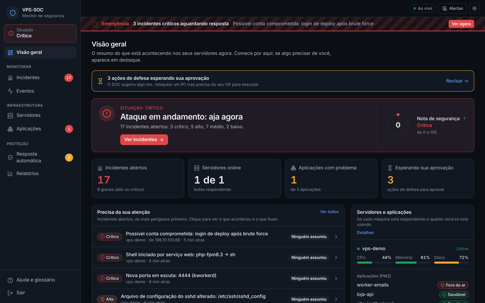
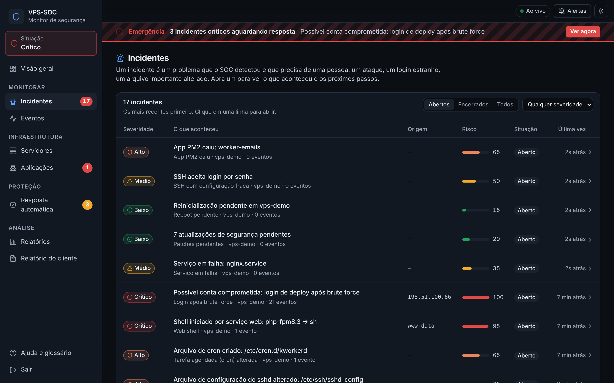
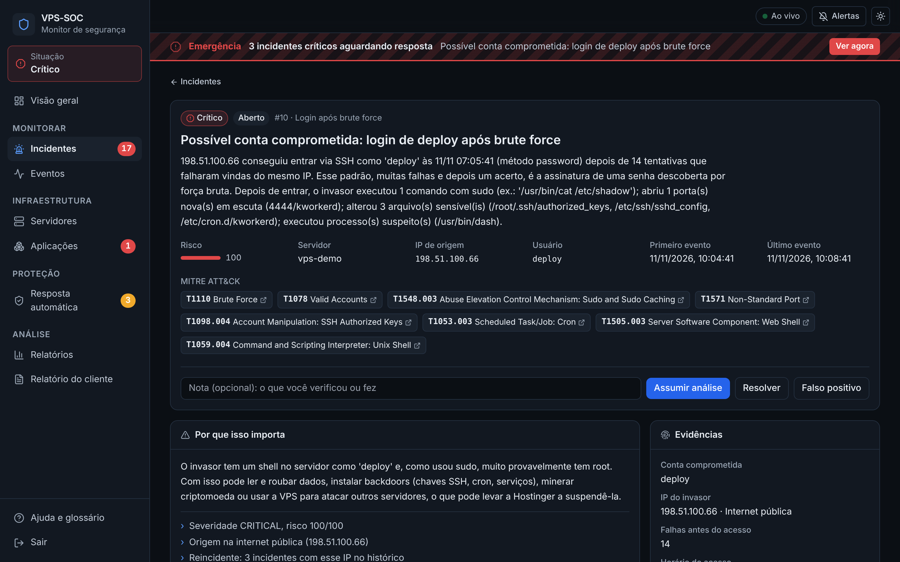
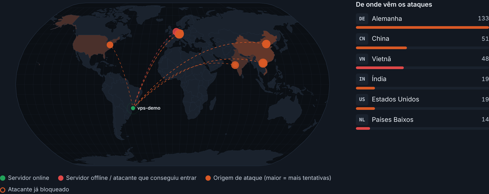
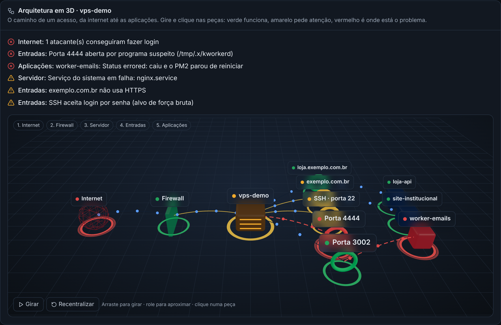
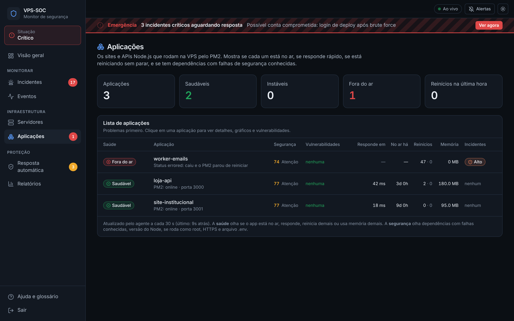
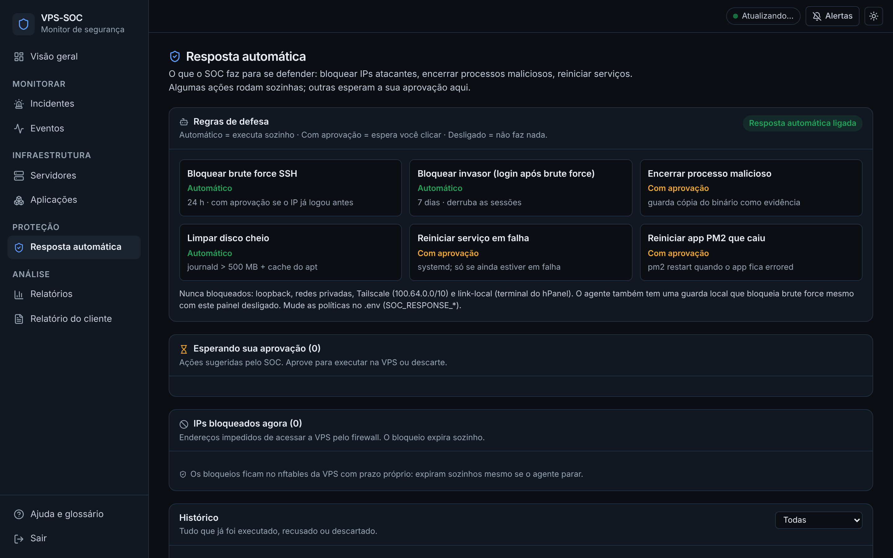
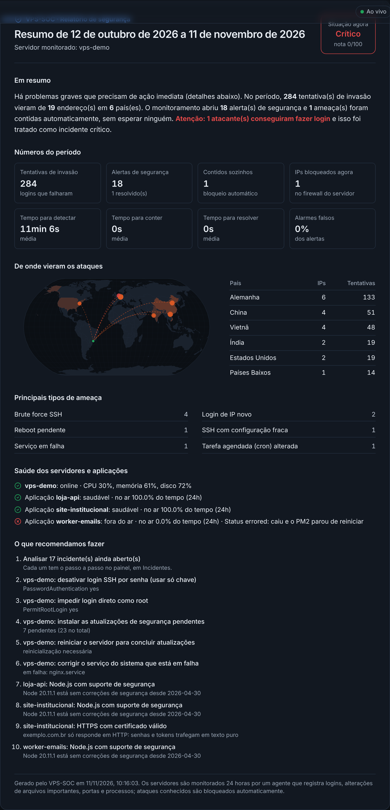
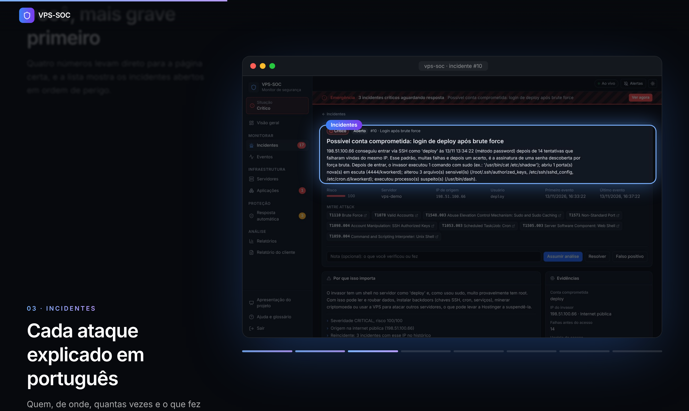

# Guia do VPS-SOC

Um guia direto para quem nunca viu o projeto. Em 10 minutos você entende o que ele faz,
como roda e como usar o painel.

**Sumário**

1. [O que é](#1-o-que-é)
2. [Como funciona](#2-como-funciona)
3. [Conceitos em 1 minuto](#3-conceitos-em-1-minuto)
4. [Rodando na sua máquina](#4-rodando-na-sua-máquina)
5. [Tour pelo painel](#5-tour-pelo-painel)
6. [Rotina de uso](#6-rotina-de-uso)
7. [Conectando uma VPS de verdade](#7-conectando-uma-vps-de-verdade)
8. [Problemas comuns](#8-problemas-comuns)
9. [Onde fica cada coisa no código](#9-onde-fica-cada-coisa-no-código)
10. [Glossário](#10-glossário)

---

## 1. O que é

O VPS-SOC é um **mini centro de operações de segurança (SOC)** para servidores Linux (VPS).

Ele faz três coisas:

- **Vigia** a VPS o tempo todo: logins, uso de `sudo`, portas abertas, arquivos importantes,
  processos estranhos e as aplicações Node.js do PM2.
- **Detecta** ataques e problemas, e explica cada um em português: o que aconteceu, por que
  importa e o que fazer.
- **Reage** sozinho quando é seguro (por exemplo, bloqueia o IP de quem está tentando
  adivinhar a senha) ou pede sua aprovação antes.



## 2. Como funciona

```
  VPS (Linux)                                Seu computador (ou outra máquina)
 ┌──────────────────┐   eventos a cada      ┌──────────────────────────────────────┐
 │ Agente (Go)      │   poucos segundos     │  Painel web (React) ← você usa aqui   │
 │ • lê os logs     │ ────────────────────▶ │  Backend (Java / Spring Boot)        │
 │ • portas         │                       │   ├ detecta e abre incidentes        │
 │ • arquivos       │ ◀──────────────────── │   ├ calcula risco e explica          │
 │ • processos, PM2 │   ordens de defesa    │   └ manda alertas (Telegram)         │
 └──────────────────┘   (ex.: bloquear IP)  │  Banco de dados (PostgreSQL)         │
                                            └──────────────────────────────────────┘
```

São três partes:

| Parte | Tecnologia | Onde roda | O que faz |
|---|---|---|---|
| **Agente** | Go | Na VPS monitorada | Coleta tudo e envia. Executa ações de defesa. |
| **Backend** | Java 21 + Spring Boot + PostgreSQL | Fora da VPS | Recebe os dados, aplica as regras de detecção, guarda o histórico. |
| **Painel** | React + TypeScript | No navegador | Mostra tudo e deixa você agir. |

**Por que o backend fica fora da VPS?** Se um atacante invadir a VPS, ele não consegue apagar
o histórico do que fez. E se ele desligar o agente, o silêncio vira um alerta
(“servidor offline”).

A ligação entre a VPS e o backend normalmente passa pelo **Tailscale**, uma VPN gratuita
que cria uma rede privada entre as máquinas (os IPs dela começam com `100.`).

## 3. Conceitos em 1 minuto

| Termo | Em uma frase |
|---|---|
| **Evento** | Um fato registrado pelo agente. Ex.: “login SSH falhou, usuário root, IP 203.0.113.10”. |
| **Incidente** | Um problema que precisa de uma pessoa. Nasce quando eventos formam um padrão perigoso. Ex.: 50 logins falhos do mesmo IP em 1 minuto = *brute force*. |
| **Severidade** | O quão grave é: **Crítico** (aja agora), **Alto**, **Médio**, **Baixo**. |
| **Risco** | Nota de 0 a 100 de cada incidente. Sobe com sinais agravantes (ex.: o atacante conseguiu entrar). |
| **Nota de segurança** | Começa em 100 e perde 40/20/5/1 pontos por incidente crítico/alto/médio/baixo aberto. |
| **Resposta automática** | Ação de defesa feita pelo agente: bloquear IP, encerrar processo, reiniciar serviço. |

O caminho é sempre o mesmo: **eventos → regra de detecção → incidente → resposta**.

## 4. Rodando na sua máquina

Você precisa de **Docker** (Docker Desktop no Windows/Mac, ou Docker Engine no Linux) e, para
o simulador de ataque, **Node.js 18+**.

**1. Configure os segredos**

```bash
cp .env.example .env
```

Abra o `.env` e preencha as três primeiras linhas. Para gerar cada valor:

```bash
openssl rand -hex 32
```

| Variável | Para que serve |
|---|---|
| `SOC_DB_PASSWORD` | Senha do banco de dados. |
| `SOC_AGENT_TOKEN` | Senha que o agente usa para mandar dados. Tem que ser igual na VPS. |
| `SOC_DASHBOARD_TOKEN` | Senha para entrar no painel. |

**2. Suba tudo**

```bash
docker compose up -d --build
```

**3. Abra o painel**

Acesse http://localhost:8088 e entre com o valor de `SOC_DASHBOARD_TOKEN`.

**4. Veja um ataque simulado** (opcional, mas recomendado)

```bash
node scripts/simulate-attack.mjs
```

O simulador finge ser uma VPS sendo atacada: força bruta, invasão, uso de `sudo`, porta
suspeita, chave SSH plantada e *web shell*. Em poucos segundos o painel fica cheio de
incidentes para você explorar. Depois de ~90 s o servidor de mentira aparece como
“offline”; isso é esperado.

> **Porta ocupada?** Se aparecer `Bind for 0.0.0.0:8088 failed: port is already allocated`,
> outro programa já usa essa porta. Troque `SOC_PORT` no `.env` (ex.: `8090`) e rode o
> `docker compose up -d` de novo.

## 5. Tour pelo painel

O menu fica à esquerda (no celular, no botão ☰). No topo de cada página há uma frase
explicando o que ela mostra.

### Visão geral

A primeira tela. Responde: **está tudo bem?**

- O **quadro grande** mostra a situação (Normal, Baixo, Elevado, Alto, Crítico) e a nota de
  segurança.
- Os **quatro números** levam direto à página certa: incidentes abertos, servidores online,
  aplicações com problema e ações esperando aprovação.
- **Precisa da sua atenção** lista os incidentes mais perigosos.

### Incidentes

A lista de problemas detectados. Filtre por **Abertos / Encerrados / Todos** e por severidade.



Ao abrir um incidente você vê:

- **O que aconteceu**, em texto, com os dados reais (quem, de onde, quando, quantas vezes).
- **Por que isso importa** e o que elevou o risco.
- **Resposta do SOC**: o que já foi feito sozinho e o que espera aprovação.
- **Próximos passos** com comandos prontos para copiar e colar no terminal da VPS.
- **Evidências**, **perfil do IP** (histórico do atacante, botão de bloquear) e
  **pode ser falso positivo?**.

Os botões **Assumir análise**, **Resolver** e **Falso positivo** mudam o estado do incidente.



### Eventos

O registro de tudo que o agente viu. Use os filtros de **tipo**, **IP** e **usuário** para
investigar. Clique em uma linha para ver os detalhes técnicos.

### Servidores

**Mapa-múndi.** Mostra onde fica cada servidor (ponto verde, ou vermelho se estiver offline)
e de onde vieram os ataques das últimas 24 horas. Cada ponto laranja é um endereço que
tentou entrar: quanto maior, mais tentativas. As linhas ligam o atacante ao servidor, e um
ponto vermelho é um atacante que **conseguiu** fazer login. Ao lado, os países que mais
atacaram. Passe o mouse em um ponto para ver o IP, a cidade e o provedor.



**Arquitetura em 3D.** Um modelo 3D do caminho que um acesso faz, da internet até as
aplicações: *Internet (globo) → Firewall (parede) → Servidor (caixa) → Entradas (portais: domínios
e portas abertas) → Aplicações (cubos)*. Cada peça fica sobre um anel com a cor do seu estado
(verde funciona, amarelo atenção, vermelho problema). Pontinhos azuis andam pelas linhas como se
fossem o tráfego; numa peça quebrada eles ficam vermelhos e somem antes de chegar.

- **Arraste** para girar, **role** para aproximar e **clique** numa peça para ver o que ela é,
  o problema e o botão **Abrir detalhes**.
- **Girar** liga a rotação automática; **Recentralizar** volta para a visão inicial.
- Acima do modelo vem a lista do que está errado, em português.

O mesmo modelo aparece na página **Aplicações**.



**Ficha do servidor.** CPU, memória, disco, rede, quem está logado, portas abertas e um
**checklist de segurança** (SSH só com chave, sem login root por senha, atualizações em dia…).

> **Como colocar o servidor no mapa:** escreva o IP público da VPS no `.env` do SOC (é o IP que
> aparece no painel da hospedagem, ou na tela de boas-vindas quando você entra na VPS) e rode
> `docker compose up -d`:
>
> ```
> SOC_SERVER_PUBLIC_IP=82.25.79.73
> ```
>
> Com mais de um servidor, use `nome=ip` separados por vírgula:
> `SOC_SERVER_PUBLIC_IP=srv731680=82.25.79.73,web2=203.0.113.9`. Sem essa linha, o SOC usa o
> IP que o agente informa (versões novas do agente fazem isso sozinhas) ou o campo
> “Onde fica…?” que aparece no próprio mapa.
>
> **Como o SOC sabe onde ficam os IPs?** Ele consulta a localização aproximada de cada IP
> público num serviço gratuito (ipwho.is), enviando só o endereço, e guarda a resposta para não
> perguntar de novo. Para desligar, use `SOC_GEOIP_ENABLED=false` no `.env`.

### Aplicações

As aplicações Node.js gerenciadas pelo **PM2** na VPS. Para cada uma: se está no ar, se
responde, quanto tempo leva, quantas vezes reiniciou, nota de segurança e dependências npm
com falhas conhecidas (consultadas na base pública OSV.dev).



### Resposta automática

- **Regras de defesa**: o que o SOC faz sozinho (*Automático*), o que pede sua aprovação
  (*Com aprovação*) e o que está desligado. Muda no `.env` (`SOC_RESPONSE_*`).
- **Esperando sua aprovação**: clique em **Aprovar e executar** ou **Descartar**.
- **IPs bloqueados agora**, com botão para desbloquear.
- **Histórico** de tudo que foi feito.



### Relatórios

Métricas para apresentar resultados: tempos médios de resposta (MTTD, MTTA, MTTC, MTTR),
quanto foi contido sozinho, alarmes falsos, gráfico de eventos por tipo e o
**mapa MITRE ATT&CK** com as técnicas vistas nos incidentes abertos.

### Relatório do cliente

Uma página pronta para mandar a um **cliente, professor ou gestor** que não usa o painel. Em
linguagem simples, ela resume o período escolhido (7 ou 30 dias):

- a situação atual e uma frase de resumo;
- quantas tentativas de invasão houve, quantos alertas e quantos foram contidos sozinhos;
- o mapa e a tabela de países de onde vieram os ataques;
- os principais tipos de ameaça;
- a saúde de servidores e aplicações;
- **o que recomendamos fazer**, em ordem.

Clique em **Imprimir / salvar PDF**: o relatório sai em fundo branco, sem o menu, pronto para
anexar num e-mail. Também dá para chegar nele pelo botão em **Relatórios**.



### Apresentação do projeto

Uma apresentação no estilo das páginas de produto, feita só com **prints reais do painel** e
efeitos que acompanham a rolagem do mouse (*scroll-telling*):

- **Rolagem suave**, com inércia, como em sites de produto (biblioteca Lenis).
- **Abertura:** o título surge palavra por palavra e o print do painel sobe e se endireita
  conforme você rola.
- **O problema:** a frase vai acendendo palavra por palavra.
- **O painel:** uma janela de navegador fica fixa mostrando a **tela inteira**, e um destaque
  desliza até a parte de que o texto fala, escurecendo o resto. As telas são: visão geral,
  incidente, mapa, aplicações, resposta automática e relatório. Clique nos traços abaixo da
  janela para pular de passo.
- **O que detecta:** uma faixa que corre sozinha com os tipos de ataque e problema.
- **Como funciona:** a seção trava na tela e os passos (agente → túnel → detecção → resposta →
  alerta) andam para o lado enquanto você rola para baixo.
- **Números** que contam sozinhos e uma **galeria em mosaico** com as telas reais, que se abrem
  ao aparecer, cada uma com legenda.

Abra em **`/apresentacao`** (por exemplo `http://localhost:8088/apresentacao`). Ela **não pede
login** e usa dados de demonstração, então dá para projetar numa aula ou mandar o link. Também
há um atalho no menu lateral (**Apresentação do projeto**) e na tela de login.



**Versão em arquivo único (para levar a outro PC).** O arquivo
[`docs/apresentacao/VPS-SOC-apresentacao.html`](apresentacao/VPS-SOC-apresentacao.html) tem
tudo dentro: textos, imagens e estilo (cerca de 1,6 MB). Baixe, dê dois cliques e ele abre no navegador, **sem
internet, sem Docker e sem login**. No GitHub, abra o arquivo e clique em *Download raw file*.
As telas usadas ficam em `frontend/src/assets/presentation/` (JPG de 1600×1000); troque
por prints novos se o painel mudar. Para gerar o arquivo de novo depois de mudar a apresentação:

```bash
cd frontend && npm run build:presentation
```

### Ajuda e glossário

Dentro do próprio painel: a rotina em 3 passos, o que tem em cada página, glossário e
problemas comuns.

### Tempo real

O painel fica **ao vivo**: o servidor do SOC avisa o navegador no instante em que algo muda
(Server-Sent Events), e o painel atualiza só o que mudou. Um ataque grave vira alarme na tela
em menos de meio segundo depois de chegar ao SOC. O indicador no topo mostra **Ao vivo** (verde)
quando essa conexão está aberta; se ela cair, o painel continua se atualizando a cada poucos
segundos e reconecta sozinho.

Do lado da VPS, o agente:

- envia cada evento na hora (junta só o que chega em 0,15 s, para um ataque em rajada ir num
  envio só);
- deixa uma conexão aberta esperando ordens (*long polling*): quando o SOC decide bloquear um IP,
  a ordem chega ao agente em milissegundos;
- percebe **na hora** (≈1 s) quando um app do PM2 cai, é parado, reinicia ou volta: ele olha os
  processos filhos do PM2 a cada segundo (leitura barata do `/proc`) e só chama o `pm2 jlist`
  quando algo mudou;
- confere os serviços systemd em falha a cada 2 s (antes: a cada 5 min);
- é avisado pelo kernel na hora em que um arquivo crítico muda (`sudoers`, `authorized_keys`,
  `sshd_config`...) e quando qualquer programa é executado, então até um malware que roda por meio
  segundo em `/tmp` aparece;
- lê os logs de acesso do nginx e avisa quando um IP tenta SQL injection, path traversal,
  Log4Shell etc. nos seus sites;
- guarda em disco os eventos que não conseguiu enviar (SOC desligado), e manda tudo quando volta;
- quando um serviço cai ou volta, ou depois de executar uma ação (ex.: reiniciar pelo SOC), manda
  o sinal de vida **na mesma hora** com o estado novo, então o incidente abre/fecha e o painel
  atualiza em 1–2 s, sem esperar o próximo ciclo;
- confere portas a cada 10 s, processos a cada 5 s e arquivos críticos a cada 15 s, e manda
  sinal de vida a cada 15 s (servidor parado vira alerta em cerca de 45 s).

> Essas melhorias do agente valem depois de **atualizar o agente na VPS** (seção *Instalando o
> agente na VPS* do README). Com o agente antigo tudo continua funcionando, só que as ordens
> chegam a cada 5 s, como antes.

### Alertas e tema

No canto superior direito:

- **Alertas**: liga/desliga o som de alarme, as notificações do navegador, mostra se o
  Telegram está configurado e tem um botão para testar o alarme.
- **☀/☾**: alterna entre tema escuro e claro.
- **Ao vivo / Sem conexão**: mostra se o painel está conseguindo falar com o backend.

## 6. Rotina de uso

1. **Abra a Visão geral.** Verde = nada a fazer.
2. **Abra o incidente mais grave** e clique em **Assumir análise** (avisa a equipe que você
   está cuidando).
3. **Leia e siga os próximos passos.** Se houver ação esperando aprovação, decida.
4. **Feche o incidente**: **Resolver** (era real e foi tratado) ou **Falso positivo**
   (não era ataque). Escreva uma nota curta dizendo o que você viu.

## 7. Conectando uma VPS de verdade

**1. Rede:** instale o [Tailscale](https://tailscale.com/download) na VPS e na máquina do SOC,
na mesma conta. Descubra o IP da máquina do SOC:

```bash
tailscale ip -4
```

**2. Painel acessível pela VPN:** no `.env` da máquina do SOC, use esse IP:

```
SOC_BIND=100.x.y.z
SOC_PORT=8088
```

```bash
docker compose up -d
```

**3. Agente:** siga a seção *Instalando o agente na VPS* do [README](../README.md). No
arquivo `/etc/vps-soc-agent/agent.env` da VPS, configure:

```
SOC_SERVER_URL=http://100.x.y.z:8088
SOC_AGENT_TOKEN=<o mesmo valor do .env do SOC>
SOC_ALLOW_INSECURE_HTTP=true
```

(`SOC_ALLOW_INSECURE_HTTP=true` é seguro aqui porque o Tailscale já criptografa o tráfego.)

**4. Confira:** em até 30 s o servidor aparece em **Servidores** como *Online*.

## 8. Problemas comuns

**O painel abre, mas está tudo zerado e “Servidores online: 0 de 0”**

Nenhum agente está mandando dados para este SOC. Na VPS:

```bash
journalctl -u vps-soc-agent -n 30 --no-pager
```

Se aparecer `heartbeat failed ... context deadline exceeded`, o agente não alcança o endereço
configurado. Veja qual é:

```bash
grep SOC_SERVER_URL /etc/vps-soc-agent/agent.env
```

O IP e a porta têm que ser os da máquina onde o painel está rodando **agora**. Teste da VPS:

```bash
curl -s -o /dev/null -w '%{http_code}\n' http://100.x.y.z:8088/
```

Deve responder `200`. Corrija o arquivo e reinicie o agente:

```bash
systemctl restart vps-soc-agent
```

> Cada computador tem o seu próprio banco de dados. Se você rodou o SOC em um PC e depois em
> outro, os dados do primeiro ficam lá. Para levar o histórico junto, use `pg_dump` no PC
> antigo e `pg_restore` no novo.

**Erro 401 no log do agente:** o `SOC_AGENT_TOKEN` da VPS é diferente do `.env` do SOC.

**Um servidor aparece como Offline:** a VPS desligou, o agente parou ou o Tailscale caiu.
Na VPS: `systemctl status vps-soc-agent` e `tailscale status`.

**`no configuration file provided: not found`:** você rodou `docker compose` fora da pasta
do projeto. Entre nela primeiro (`cd vps-soc`).

**`port is already allocated`:** outra coisa usa a porta. Descubra o quê com
`docker ps` ou `sudo ss -ltnp 'sport = :8088'` e troque `SOC_PORT` no `.env`.

**Não ouço o alarme:** o navegador só libera som depois de um clique. Clique em
**Ativar som** no topo, ou em **Alertas → Testar alarme**.

## 9. Onde fica cada coisa no código

```
vps-soc/
├── agent/            Agente em Go (roda na VPS)
│   ├── cmd/          ponto de entrada
│   ├── internal/     coletores (logs, portas, arquivos, processos, PM2) e resposta ativa
│   └── deploy/       install.sh, serviço systemd, exemplo de configuração
├── backend/          API em Java / Spring Boot
│   └── src/main/java/com/vpssoc/
│       ├── ingest/      recebe os dados do agente
│       ├── detection/   regras de detecção (uma classe por regra em rules/)
│       ├── incident/    abre, agrupa e fecha incidentes
│       ├── insight/     gera os textos “o que aconteceu / próximos passos”
│       ├── response/    decide e acompanha as ações de defesa
│       └── api/         endpoints usados pelo painel
├── frontend/         Painel em React + TypeScript
│   └── src/
│       ├── pages/       uma tela por arquivo (Overview, Incidents, Hosts…)
│       └── components/  peças reutilizadas (menu lateral, alertas, badges…)
├── scripts/          simulate-attack.mjs (ataque de demonstração)
└── docs/             esta documentação
```

**Quero criar uma regra de detecção nova:** crie uma classe em
`backend/src/main/java/com/vpssoc/detection/rules/` seguindo o modelo das existentes e
registre o ID em `RuleIds.java`. Depois rode `node scripts/simulate-attack.mjs` para ver no
painel.

**Quero mexer no painel:** com o backend rodando, entre em `frontend/` e rode
`npm install` e `npm run dev`. O painel abre em http://localhost:5173 e recarrega sozinho a
cada mudança.

## 10. Glossário

| Termo | Significado |
|---|---|
| **SOC** | *Security Operations Center*: equipe e ferramentas que vigiam sistemas e respondem a ataques. |
| **SIEM** | Sistema que junta logs de várias fontes e procura ataques neles. O VPS-SOC é um mini SIEM. |
| **Agente** | Programa instalado na VPS que coleta dados e executa ações de defesa. |
| **Heartbeat** | “Sinal de vida” que o agente manda a cada 30 s. Sem ele, o servidor vira *offline*. |
| **Brute force** | Ataque de força bruta: tentar milhares de senhas até acertar. |
| **Password spraying** | Variação: tentar poucas senhas comuns em muitos usuários. |
| **Falso positivo** | Alarme que disparou mas não era ataque. |
| **FIM** | *File Integrity Monitoring*: vigiar se arquivos importantes (sudoers, chaves SSH, cron) mudaram. |
| **Web shell** | Script plantado num site que dá ao atacante um terminal no servidor. |
| **MITRE ATT&CK** | Catálogo público das técnicas de ataque (ex.: T1110 = força bruta). |
| **MTTD / MTTA / MTTC / MTTR** | Tempo médio para **D**etectar, **A**ssumir, **C**onter e **R**esolver um incidente. |
| **PM2** | Gerenciador que mantém aplicações Node.js rodando e as reinicia se caírem. |
| **nftables** | Firewall do Linux. É onde o agente coloca os IPs bloqueados. |
| **Tailscale** | VPN que cria uma rede privada entre suas máquinas. IPs começam com `100.`. |
| **OSV.dev** | Base pública de vulnerabilidades conhecidas em pacotes (npm, PyPI…). |
